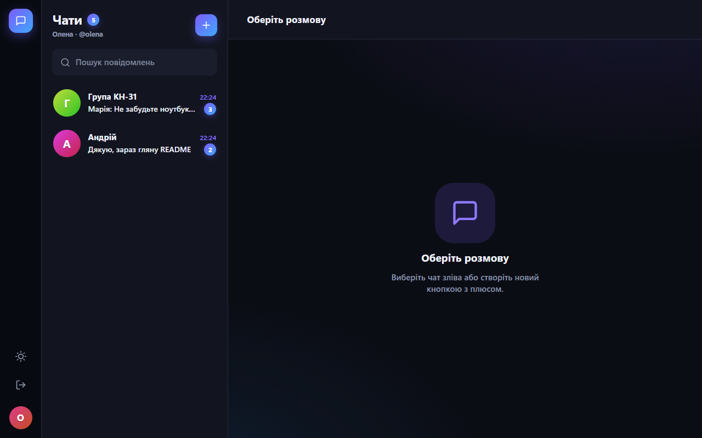
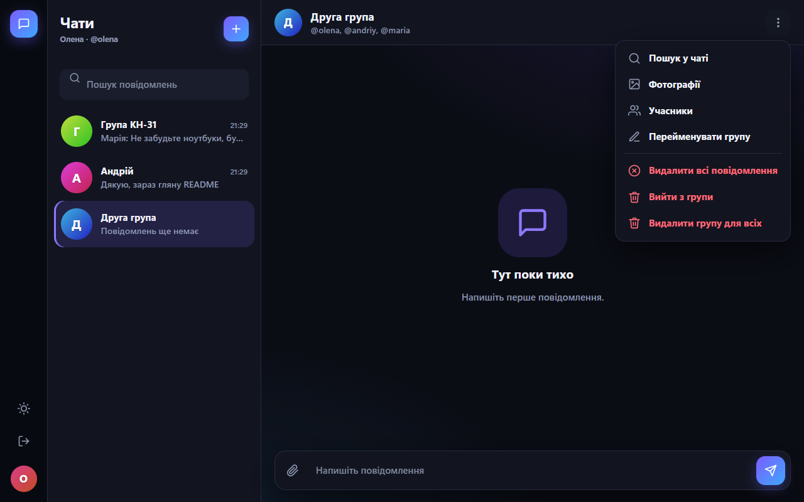
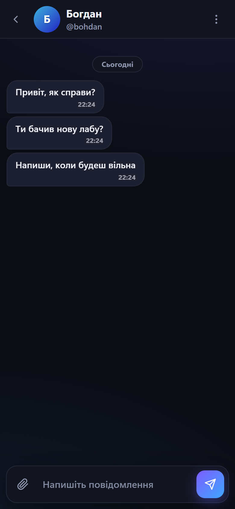

# Messenger

Веб-месенджер на Python (FastAPI): користувачі з тегами й паролями, особисті та групові чати, фото, пошук,
блокування, адміністратор групи, світла й темна теми. Дані зберігаються на диску й переживають перезапуск.




 

## Рівень

- **Basic і Standard** повністю.
- **Advanced:** автентифікація (хеші паролів, токени сесій) і веб-інтерфейс з опитуванням раз на 2 секунди.
- Додатково: фото в повідомленнях (великі стискаються в браузері перед відправкою), блокування, групи з адміном і перейменуванням, лічильники непрочитаних, чернетки, пошук із переходом до повідомлення, адаптація під телефон.

## Запуск

```bash
python -m venv .venv
.venv\Scripts\activate        # Windows
pip install -r requirements.txt
uvicorn app.main:app --reload
```

Відкрийте http://127.0.0.1:8000. Документація API: `/docs` та [docs/API.md](docs/API.md).

### CalorieBot

Кожен користувач автоматично отримує чат із ботом на вкладці **BOTS** (звичайні розмови й групи лежать у **DM**).
Надішліть боту фото їжі, і він відповість приблизною калорійністю та БЖВ.

**Основний варіант: безкоштовний Gemini API.** Ключ без картки: <https://aistudio.google.com/apikey> → «Create API key».
Збережіть його у файлі `.env` у корені проєкту (файл у `.gitignore`) і перезапустіть сервер:

```
GEMINI_API_KEY=ваш_ключ
```

Модель змінюється змінною `GEMINI_MODEL` (за замовчуванням `gemini-3.1-flash-lite`). Фото надсилається до Google.

**Запасний варіант без ключа: локальна модель через [Ollama](https://ollama.com)**, фото не покидає комп'ютер:

```bash
ollama pull qwen2.5vl:3b  # один раз, ~3,2 ГБ
ollama serve              # якщо Ollama ще не працює
```

Модель і адресу змінюють `CALORIE_BOT_MODEL` та `OLLAMA_URL`. Якщо задано `GEMINI_API_KEY`, використовується Gemini,
інакше Ollama. Коли жоден варіант недоступний, бот відповідає в чаті, чому. Увійти як бот неможливо.

Свого користувача створіть на вкладці «Реєстрація»: ім'я, унікальний тег, пароль двічі.

## Тести

```bash
pytest
```

## Як зберігаються дані

Увесь набір даних (користувачі, розмови, повідомлення, сесії) лежить в одному JSON-файлі `data/messenger.db`
(шлях змінюється змінною `MESSENGER_DATA`). Сервіс завантажує його один раз під час старту, тримає в пам'яті й
записує після кожної зміни. Запис атомарний: дані пишуться у тимчасовий файл поруч, скидаються на диск (`fsync`)
і замінюють справжній файл через `os.replace`, тож збій посеред запису не псує вже збережене.
Якщо файл пошкоджений, сервіс кидає `StorageError`, а API відповідає `500` з зрозумілим текстом.
Час повідомлень зберігається в UTC, а в браузері показується в локальній зоні.
Фото лежать окремими файлами в `data/uploads/`, у JSON є лише їхні імена.

**Паролі** не зберігаються: тільки солоний хеш scrypt. Токен сесії видається випадковим, на диску лежить лише його SHA-256.

## Валідація

- Повідомлення: не порожнє (якщо немає фото), до 2000 символів, пробіли по краях обрізаються.
- Ім'я: до 32 символів, літери/цифри/`.`/`_`/`-`, унікальне. Тег: 3-32 символи, латиниця/цифри/`_`, унікальний.
- Пароль: від 6 символів, підтверджується повторним введенням.
- Розмова: щонайменше 2 учасники, усі мають існувати; група це 3 і більше. Особистий чат з однією людиною лише один, назва групи до 64 символів.
- Фото: PNG, JPEG, GIF або WEBP до 5 МБ, тип перевіряється за вмістом файлу.
- Усі правила діють на сервері; інтерфейс показує помилки у форматі «Помилка: повідомлення не може бути порожнім.».

## Структура

```
app/
  models.py        # User, Conversation, Message
  validation.py    # правила й ValidationError / AuthError
  bot.py           # CalorieBot: калорії за фото (Ollama)
  security.py      # хешування паролів (scrypt)
  storage.py       # SQLite, StorageError
  services.py      # MessengerService: уся бізнес-логіка
  api.py           # REST API (FastAPI), токени сесій
  main.py          # застосунок
  static/          # веб-інтерфейс (index.html)
tests/             # pytest
docs/              # API.md, TASKS.md, скріншоти
```

## Хто що робив

- Артем Власюк Анатолійович, группа Б-121-24-2-ПІ: backend (`app/` крім `app/static/`): моделі, сховище, сервіс, API, автентифікація.

- Даніель Євтушенко Віталійович, группа Б-121-24-2-ПІ: frontend (`app/static/`): інтерфейс чату.
 
